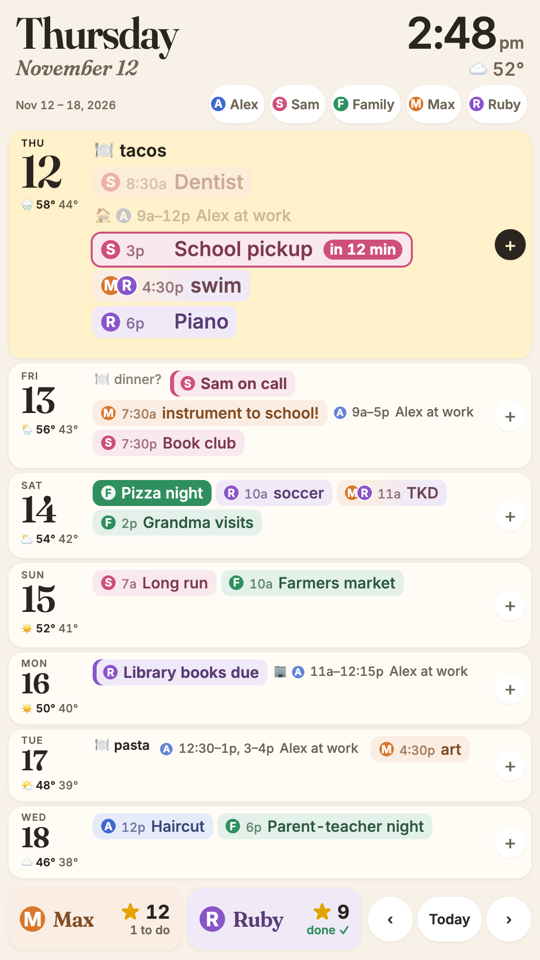
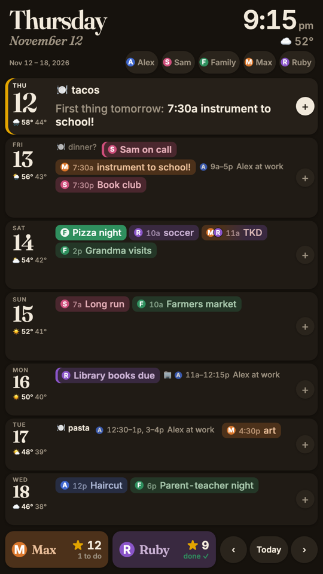

# homeboard

A family wall calendar for a cheap touchscreen in the kitchen. One Cloudflare Worker, no database,
no framework, no build step. Google Calendar holds everything, so the family keeps using the calendar
apps they already have and the wall just shows it.

<p>
  
  
</p>

## What it does

- **A rolling seven days** starting today, sized for a portrait 1080×1920 screen. Today is a big card
  with finished events dimmed and the next one called out ("in 12 min"). If a busy week won't fit,
  later days shrink and then fold into one line ("4 things, first 1p") rather than scroll.
- **Everyone in their own colour** with an initial, so it doesn't rely on colour alone.
  "Max and Ruby TKD" is tagged to both kids and drawn in both colours.
- **Tap a name to filter** to one person (plus whole-family events).
- **Add, edit and delete** from the wall or a phone: big buttons, typing last.
  Writes only ever go to one shared family calendar.
- **Work calendars as quiet "at work" lines.** These are read with Google's free/busy API, so meeting
  titles never reach the wall.
- **Dinner**: "Dinner: tacos" on the family calendar becomes that day's dinner line; an empty
  "dinner?" slot invites someone to plan it.
- **Chores with stars**, for the kids by default (anyone can be given a tile). Chores can repeat on chosen weekdays. Kids tick them on the wall;
  only a signed-in grown-up can add chores or spend stars.
- **Weather** per day and now (Open-Meteo: free, no key, only your rounded town location is sent).
- **Wall-friendly**: night mode 9pm–6am; in the evening, once today is done, it folds to one line
  that says what's first tomorrow; back to today after 3 minutes untouched, an
  "updated 2h ago" warning if refreshes start failing, and a daily reload to pick up deploys.
- **Small delights** (all optional): a little animal wanders across now and then, a fun-fact card
  pops up every hour or two. Tap the weekday three times to summon a visitor, the clock three times
  for a fact.

## How it works

```
 Tablet (Fully Kiosk)        Phones / laptops
  /kiosk/?k=KEY  ─────┐      ┌─ Cloudflare Access (email code)
                      ▼      ▼
                 Cloudflare Worker (this repo)
                  │  reads every calendar on the "hub" Google account
                  │  writes ONLY to the shared family calendar
                  │  chores + the Google refresh token live in Workers KV
                  ▼
            Google Calendar  ◄── everyone's own calendar apps
```

- **The hub** is one Google account the wall signs in as, ideally a new one made for this
  (say `our.family.wall@gmail.com`). Each person shares their calendar to it, and it owns one
  secondary calendar, "Family", that everyone can see and edit.
- **Grown-ups** sign in through Cloudflare Access (an email code) on any device.
- **The tablet** can't do email codes, so it uses a long secret in its start URL once; that sets a
  cookie good for the `/kiosk/` path only. The kiosk can do everything a grown-up can except manage
  chores and stars, unless you set a grown-up PIN (below).
- **Fails closed**: no valid Access token and no kiosk key means 403, for every path.

## What you need

- A Cloudflare account with a domain on it (the free plan is plenty).
- A Google account to be the hub, and a Google Cloud project (free).
- Node.js 18 or newer (only to run `wrangler`; there are no npm dependencies).
- A touchscreen. Anything that runs a full-screen browser works; an Android tablet or wall display
  with [Fully Kiosk Browser](https://www.fully-kiosk.com/) is the easy path.

## Setup

About an hour, most of it clicking through Google and Cloudflare dashboards.

### 1. Get the code

```sh
git clone https://github.com/<you>/homeboard && cd homeboard
cp wrangler.example.toml wrangler.toml      # your config; gitignored
npm test                                    # offline tests, Google mocked
npx wrangler login
```

### 2. Google Calendar

1. Make (or pick) the **hub** account. Put its address in `HUB_EMAIL`.
2. On the hub, create a calendar called "Family" (Settings → Add calendar → Create new calendar).
   Copy its **Calendar ID** (that calendar's settings → Integrate calendar) into `FAMILY_CALENDAR_ID`.
   Share it with each grown-up's own account with "Make changes to events".
3. Each grown-up shares **their own** calendar to the hub with "See all event details", and the hub
   accepts each invite ("Add this calendar"). Map each address to a name in `CALENDAR_PEOPLE`.
4. Optional: a work calendar can be shared at free/busy level and listed in `BUSY_CALENDARS`.
   The wall only ever asks for busy times.

Tip: Google Calendar makes events created in Gmail **private** by default, and private events are
hidden from anyone with "See all event details". Set them to default visibility to show them.

### 3. Google Cloud (the wall's permission to read the calendars)

Signed in as the hub, at [console.cloud.google.com](https://console.cloud.google.com):

1. Create a project. **APIs & Services → Library**: enable **Google Calendar API**.
2. **OAuth consent screen**: if the hub is a Google Workspace account, choose **Internal**.
   For a regular Gmail hub, choose **External**, add the hub as a test user, then
   **Publish app → In production**. (In "Testing", Google expires the sign-in every 7 days and the wall
   stops updating. Unpublished-but-in-production is fine for your own use; you'll click past an
   "unverified app" warning once.)
3. Scopes: `.../auth/calendar.readonly` and `.../auth/calendar.events`.
4. **Credentials → Create credentials → OAuth client ID**, type **Web application**,
   authorized redirect URI `https://<your wall hostname>/oauth/callback`.

### 4. Cloudflare

1. Set `routes` in `wrangler.toml` to your wall's hostname (e.g. `wall.yourdomain.com`).
2. Make the KV namespace and paste its id into `wrangler.toml`:
   ```sh
   npx wrangler kv namespace create homeboard
   ```
3. Secrets (you type the values; they never go in a file):
   ```sh
   npx wrangler secret put GOOGLE_CLIENT_ID
   npx wrangler secret put GOOGLE_CLIENT_SECRET
   openssl rand -hex 24                 # save this in your password manager: it's the kiosk key
   npx wrangler secret put KIOSK_KEY    # 24+ characters, or every kiosk request is refused
   npx wrangler secret put PARENT_PIN   # optional: 4-12 digits to manage chores on the wall itself
   ```

### 5. Cloudflare Access (who can open it)

In **Zero Trust → Access → Applications**, add two **self-hosted** applications:

| Application | Domain / path | Policy |
|---|---|---|
| homeboard | `wall.yourdomain.com` | **Allow**: the grown-ups' email addresses. Session: 1 month. |
| homeboard kiosk | `wall.yourdomain.com/kiosk` | **Bypass**: Everyone (the Worker checks the kiosk key itself) |

Copy your team domain (`<team>.cloudflareaccess.com`, under Zero Trust → Settings) into
`ACCESS_TEAM_DOMAIN`, and the first application's **Application Audience (AUD) tag** into `ACCESS_AUD`.

### 6. Deploy and connect Google

```sh
npm run deploy
```

Open `https://wall.yourdomain.com/oauth/start` in a browser signed in to the hub account, pass the
Access email code, and approve. The Worker refuses any account other than `HUB_EMAIL` and stores the
refresh token in KV. You should land on the calendar.

### 7. The tablet

Point the browser at `https://wall.yourdomain.com/kiosk/?k=<KIOSK_KEY>`. With Fully Kiosk Browser:

- **Web Content**: Start URL as above. **Web Zoom**: off. **Fullscreen**: on, action bar and address bar off.
- **Device Management**: Keep Screen On; Launch on Boot. Set Fully as the Home app if your device
  allows it (Android Settings → Apps → Default apps → Home app).
- **Web Auto Reload**: on network reconnect.
- Lock rotation to portrait.
- If Fully won't start on boot, check that the screen lock is **None/Swipe** (a PIN blocks apps from
  starting before unlock), that Fully may **Display over other apps**, and, for a sideloaded APK on
  Android 13+, that you've allowed restricted settings for it.
- Screen care: use Fully's **Scheduled Sleep/Wakeup** (Power settings) to turn the screen off
  overnight, and don't run it at full brightness. LCDs don't burn in like OLEDs, but it saves power anyway.
  The scheduler is a Fully **PLUS** feature: a one-time licence of about $11 per device, free to try
  first. Everything else above works in the free version.

To lock the tablet out, change `KIOSK_KEY`.

### Updating

Your settings live in `wrangler.toml`, which git never touches, so updating is:

```sh
git pull
npm test
npm run deploy
```

The tablet picks up the new version at its daily reload, or sooner if you restart Fully.
New settings appear in `wrangler.example.toml` with sensible defaults, so an older `wrangler.toml`
keeps working; copy over any new lines you want.

## Using it

- **Adding:** tap **+** on a day. Pick who (tap several people for a shared event), when, and what.
  Saved to the Family calendar as `Name: title` (or `Max & Ruby: title`) with that person's colour,
  so it reads sensibly in Google Calendar too.
- **Editing / deleting:** tap any event that lives on the Family calendar. Events from someone's own
  calendar just tell you to change them in Google Calendar.
- **Names in titles:** on any calendar, a title that starts with a kid's name ("Max swim") is drawn
  as that kid's, and one starting with several names ("Max and Ruby TKD", "Ruby, Max: soccer") as
  all of theirs.
- **Dinner:** an all-day `Dinner: tacos` on the Family calendar, or tap "dinner?" on the wall.
- **Chores:** from a phone or laptop, tap a kid's tile, add a chore, and pick the
  days it repeats (none picked = every day). Tap the day line under a chore to change it.
  On the wall itself, kids can only tick chores off. If you set `PARENT_PIN`, a **🔒 Grown-ups**
  button under the chores unlocks adding chores and spending stars for 5 minutes (it relocks when you
  close the panel). Five wrong PINs lock the keypad for 15 minutes. Cover the keypad from small eyes.
- **Working location** (Google's Office/Home setting) shows as 🏢/🏠 on that person's work line.

## Configuration

Everything lives in `wrangler.toml` under `[vars]`; [`wrangler.example.toml`](wrangler.example.toml) is commented.

| Var | What |
|---|---|
| `HUB_EMAIL` | The Google account the wall signs in as. |
| `HUB_PERSON` | Whose events the hub's own primary calendar holds. Defaults to the first adult. |
| `FAMILY_CALENDAR_ID` | The only calendar the wall writes to. Must be a secondary `@group.calendar.google.com` calendar; the Worker refuses anything else. |
| `PEOPLE` | JSON list of `{name, color, colorId, role, chores}`. `role` is `adult`, `kid` or `shared` (exactly one `shared`: the family calendar). `chores` gives that person a chore tile; it defaults to `true` for kids and `false` for everyone else. |
| `CALENDAR_PEOPLE` | JSON `{calendarId: name}` for calendars shared to the hub. |
| `BUSY_CALENDARS` | JSON `{calendarId: name}` for calendars shown only as busy blocks. |
| `TIMEZONE` | IANA zone, e.g. `Europe/London`. |
| `TITLE`, `MEAL_LABEL`, `BUSY_LABEL` | Wording: tab title, "Dinner", "at work". |
| `WEATHER_LAT`, `WEATHER_LON`, `WEATHER_UNITS` | Blank coordinates turn weather off. Units: `fahrenheit` or `celsius`. |
| `CHORES`, `MEALS`, `VISITORS` | `true` / `false`. |
| `FACTS` | `fun` (default), `pokemon`, or `off`. |
| `ACCESS_TEAM_DOMAIN`, `ACCESS_AUD` | From Cloudflare Access. |

Secrets: `GOOGLE_CLIENT_ID`, `GOOGLE_CLIENT_SECRET`, `KIOSK_KEY`, and optionally `PARENT_PIN` (4-12 digits;
unset means chores can only be managed from a signed-in phone or laptop).

### Making it yours

- **Fact packs** live in [`src/facts/`](src/facts/). Copy `fun.js`, write your own, import it in
  `src/worker.js` next to the others, add it to `FACT_PACKS`, and set `FACTS` to its name.
- **Visitors** are emoji with CSS animations, in the `EGGS` list in `src/page.html`.
- **Look:** colours are CSS variables at the top of `src/page.html` (`:root` for day, `body.night` for night).

## Development

```sh
npm test          # offline: Google, Open-Meteo and KV are mocked
npm run dev       # wrangler dev on localhost
```

For `wrangler dev`, put `DEV_NO_AUTH = "1"` in a `.dev.vars` file to skip Cloudflare Access. It is
honoured on `localhost` only, so it can't open a deployed wall even if it ends up in production config.

The code is two files: [`src/worker.js`](src/worker.js) (Google auth, the API, access control) and
[`src/page.html`](src/page.html) (the whole UI, plain HTML/CSS/JS).

## Privacy and security

- Calendar data stays between Google, your Cloudflare account, and your screens. No analytics,
  no third-party scripts; fonts are self-hosted.
- One write path, to one calendar, whose id comes from config and never from the browser.
- Busy calendars are read with free/busy only, so their titles never leave Google.
- The Google refresh token is stored in your KV namespace; revoke it any time from the hub's
  [Google account permissions](https://myaccount.google.com/permissions).

## License

[MIT](LICENSE) © Makeshift. Fonts: Inter and Fraunces, under the SIL Open Font License
(see [`src/fonts/`](src/fonts/)).
